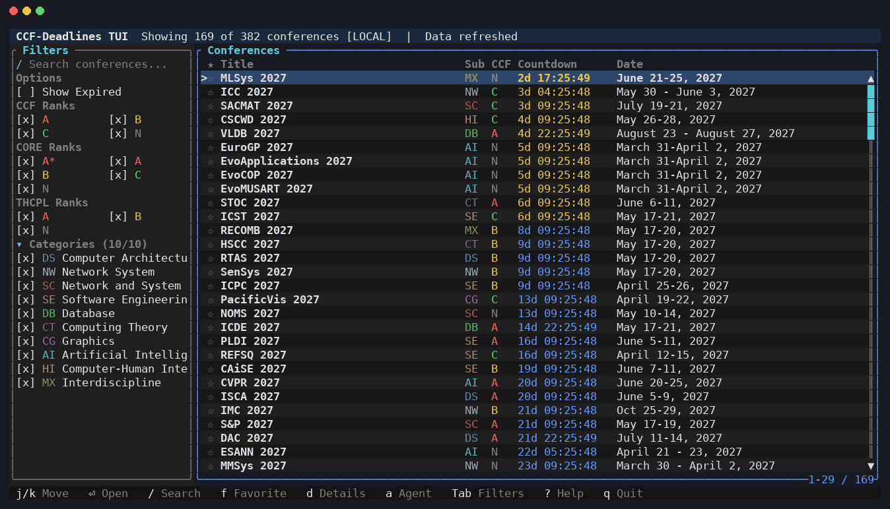
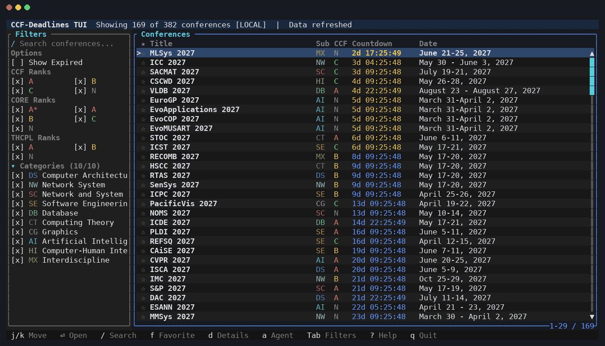
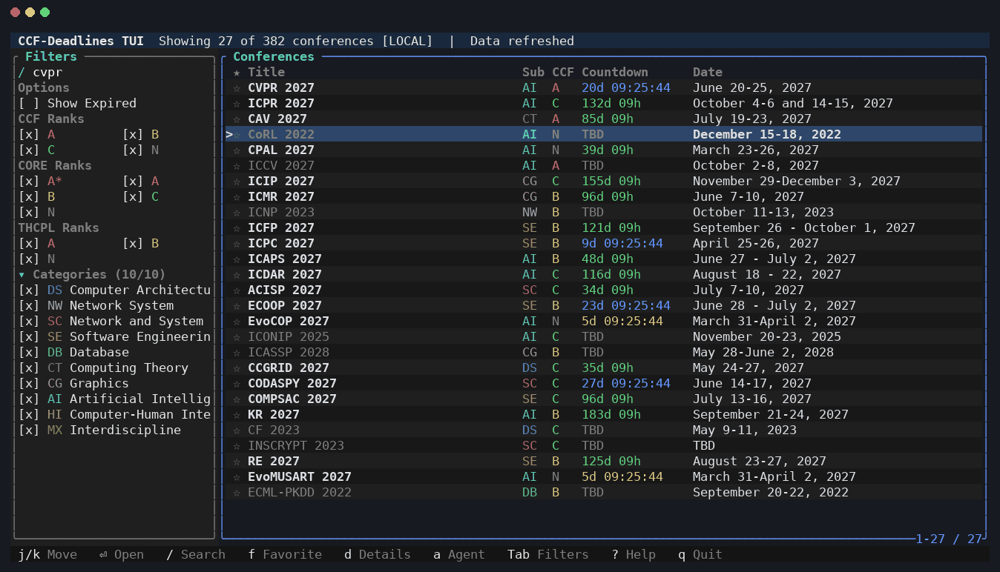
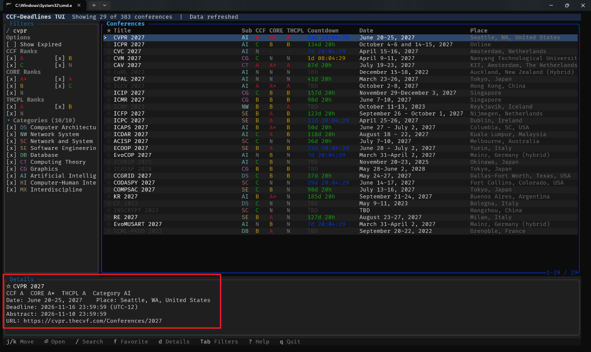
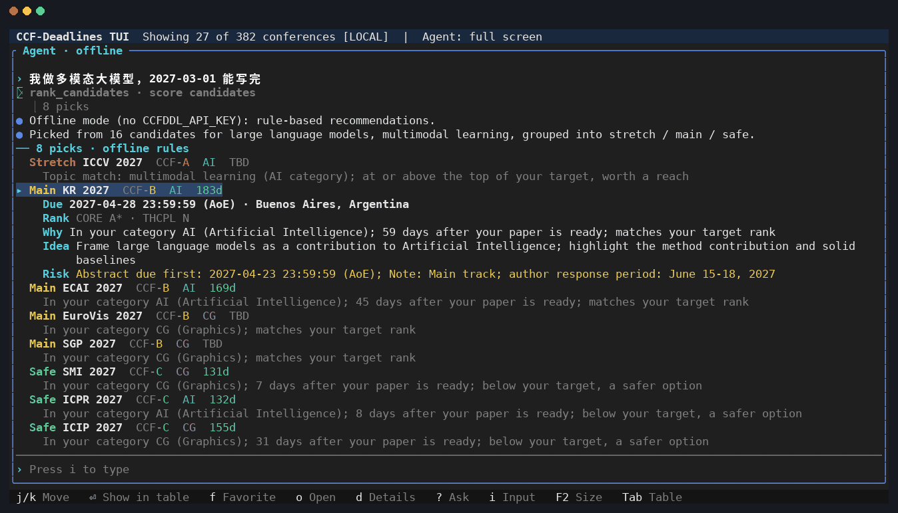

# CCF-Deadlines TUI (Rust)

[](https://github.com/tkzzzzzz6/ccfddl-tui-rs/actions/workflows/ci.yml)
[](https://github.com/tkzzzzzz6/ccfddl-tui-rs/releases/latest)
[](https://crates.io/crates/ccfddl-tui)
[](https://crates.io/crates/ccfddl-tui)
[](Cargo.toml)
[](#installation)
[](LICENSE)

A terminal UI for tracking CCF-ranked conference deadlines with live countdowns.

This repository is an independently maintained derivative of
[ccfddl/tui](https://github.com/ccfddl/tui), reimplemented in Rust with a
ratatui interface. The data layer preserves behaviour compatibility with the
upstream Python/Textual implementation and is verified by `tests/golden.rs`,
which compares rows, sort order, fuzzy search and duration formatting against
snapshots generated from the upstream code.

## Demo

A real recording of the release binary (embedded data, no API key): browse the
table, search for CVPR, open its details, then ask the recommendation agent
"我做多模态大模型，2027-03-01 能写完", open a card and ask why it was picked.



<details>
<summary>Screenshots</summary>

### Main interface



### Relevance-first search



### Conference details



### Recommendation agent



</details>

## Status

| Area | State |
|------|-------|
| Data model, timezone parsing, row building | ported, golden-verified |
| Filtering, fuzzy search, sorting | ported, golden-verified |
| Favourites (`~/.ccfddl/favorites.json`) | ported, shared file format |
| Remote / cache / embedded fallback | ported (embedded snapshot is extra) |
| Terminal UI | ratatui, keyboard and mouse |
| Mouse hit testing, wheel scrolling, scrollbars | implemented and covered by `tests/ui_mouse.rs` |
| Responsive columns and conference details | implemented |
| Initial load and refresh | asynchronous; the UI remains responsive |
| Conference recommendation agent | offline rules, optional LLM tool loop, TUI panel |

## Installation

Install from [crates.io](https://crates.io/crates/ccfddl-tui) with Cargo. This
requires a Rust toolchain ([rustup.rs](https://rustup.rs)) and works on macOS
(Apple Silicon and Intel), Linux and Windows:

```bash
cargo install ccfddl-tui --locked
ccfddl-tui --version
```

Run the same command again to upgrade to the latest release; it does nothing
when you are already up to date. To remove it:

```bash
cargo uninstall ccfddl-tui
```

To try unreleased changes from the `master` branch instead:

```bash
cargo install --git https://github.com/tkzzzzzz6/ccfddl-tui-rs --locked
```

## Usage

```bash
cargo run --release                 # start the TUI
cargo run --release -- --list       # print the table and exit
cargo run --release -- --url URL    # custom data source
cargo run --release -- --recommend  # print recommendations and exit
cargo run --release -- --ask "multimodal LLM, ready 2027-03-01" --zh
```

## Keyboard

### Table (default focus)

| Key | Action |
|-----|--------|
| `j` / `↓` | Move down |
| `k` / `↑` | Move up |
| `g` / `G` | First / last row |
| `Enter` | Open the conference URL in the default browser |
| `f` | Toggle favourite |
| `d` | Show / hide conference details |
| `a` / `A` | Open the recommendation agent / ask it about the selected conference |
| `s` | Cycle the sort column |
| `S` | Reverse the sort direction |
| `←` / `h`, `→` | Scroll the columns sideways when they are wider than the window |
| `=` | Restore the default column widths |
| `l` | Toggle language (EN/ZH) |
| `r` | Refresh from the data source |
| `/` | Search |
| `Tab` | Focus the filter sidebar |
| `Esc` | Reset all filters |
| `?` | Help |
| `q` | Quit |

Sorting starts at the data layer's own order (favourites first, then running by
urgency, then TBD, then finished). `s` cycles through `Title`, `Sub`, `CCF`,
`Countdown`, `Date`, `Place` and back to default; the active column is marked
with `▲`/`▼` in the table header.

### Sidebar

| Key | Action |
|-----|--------|
| `↓` / `↑` | Move the cursor between checkboxes |
| `Space` / `Enter` | Toggle the checkbox under the cursor |
| `/` | Search |
| `Tab` | Back to the table |
| `Esc` | Reset all filters |

### Search

| Key | Action |
|-----|--------|
| any character | Type into the query |
| `Backspace` | Delete |
| `Enter` | Apply and return to the table |
| `Esc` | Clear and return to the table |

Search is a separate focus mode so that `q`, `r` and `?` reach the text field
instead of triggering their global shortcuts. The search field is pinned to the
top of the sidebar; category filters can be collapsed, and rank filters are
packed two per row to keep the sidebar compact.

## Mouse

Mouse capture is enabled on startup and disabled during terminal restoration.
The interface uses the rectangles from the latest frame for hit testing, so
clicks continue to target the right control after scrolling or resizing.

| Action | Behaviour |
|--------|-----------|
| Click a conference row | Select it; click the selected row again to toggle details |
| Click a table header | Sort ascending; click the same header again to reverse |
| Click a filter checkbox | Toggle that category, rank or Show Expired |
| Click Categories | Collapse / expand the category list |
| Click the search field | Focus search input |
| Drag a `│` handle in the table header | Resize the column to its left (the right border resizes the last column) |
| Double-click a `│` handle | Restore that column's default width |
| Wheel over the table | Move through conferences with a persistent scroll offset |
| `Shift` + wheel, horizontal wheel | Scroll the columns sideways |
| Click or drag the vertical scrollbar | Jump to that position; the selection stays on screen |
| Click or drag the horizontal scrollbar | Scroll the columns (shown on the bottom border when they overflow) |
| Wheel over the sidebar | Scroll filters independently |
| Click `[x]` or outside Help | Close the help overlay |

Columns cannot be narrower than their header. Custom widths are saved to
`~/.ccfddl/layout.yaml` and reused on the next start; when the columns are
wider than the window, `★` and the title stay in place while the other columns
scroll. Right-click and mouse motion are ignored. All mouse actions have
keyboard equivalents except resizing a single column (`=` restores them all). While mouse capture is active, native terminal text
selection may require holding `Shift`, depending on the terminal.

## Layout and details

- Width ≥ 140: all nine columns.
- Width 100–139: title, category, CCF, countdown and date remain visible.
- Width < 100: a compact title / CCF / countdown table.
- Title width is capped at 36 cells; remaining space goes to dates and places.
- Full dates, places, ranks, links, abstract deadlines and comments are available
  in the optional details panel (`d` or a second click on the selected row).
- Scrollbars, row ranges, zebra rows, rounded borders, an explicit selected-row
  marker and an empty-result hint are included.
- English and Chinese labels share the same layout and functionality.

Initial loading and `r` refreshes run on a worker thread. The current rows stay
visible during refresh, and favorites changed while the worker is running are
preserved. `--list` remains a synchronous, non-interactive operation.

## Recommendation agent

The agent suggests conferences for your research and explains why: each pick
gets a tier (**stretch** / **main** / **safe**), a reason, a submission
direction and risks. Deadlines, ranks, places and dates always come from the
conference data; a model, when configured, only writes the explanations.

### Research profile

The agent reads `~/.ccfddl/profile.yaml`. Create it with `/init` in the agent
panel, or write a commented template with `--init-profile` and edit it:

```yaml
interests: ["multimodal LLM", "程序分析"]   # English or Chinese
categories: []            # CCF categories (AI, DB, SE, ...); empty = inferred
target_ranks: ["A", "B"]  # better ranks become stretch, worse ones safe picks
ready_date: '2027-03-01'  # deadlines before this are skipped
min_days_left: 14         # used when ready_date is not set
horizon_days: 365
preferred_places: ["China"]
avoided_places: []
include_tbd: true
```

### Offline mode (no API key)

Without a model the agent scores every open conference on topic match
(interests mapped to topics such as computer vision, LLMs or security, against
each venue's focus and CCF category), CCF rank versus your targets, slack
between the ready date and the deadline, and favorites / place preferences.
Explanations are generated from templates in English or Chinese. Free text in
the panel works too: `我做多模态大模型，2027-03-01 能写完` adds those interests
and that ready date for the request.

Follow-ups refine the previous request instead of starting over; the
conditions in force are shown above the cards and `/reset` clears them:

| Say | Effect |
|-----|--------|
| `只要 A 类`, `A/B 类`, `不要 C 类`, `CCF-A only`, `no ccf-c` | Only these CCF ranks |
| `只看 AI`, `只看数据库`, `only software engineering` | Only these CCF categories |
| `多推荐几个`, `推荐 10 个`, `more`, `top 12` | Number of picks |
| `换一批`, `others` | Exclude the round on screen |
| `排除 ICCV`, `不要 CVPR`, `without ICME` | Exclude conferences |
| `不要 TBD`, `no TBD` (`包括待定` undoes it) | Skip unannounced deadlines |
| `只看国内`, `亚洲`, `欧洲`, `不去美国`, `avoid the US` | Prefer / avoid places |
| `三个月内`, `半年内`, `2周内`, `within 60 days` | Deadline window |

A new research description (`我做数据库`) replaces the previous one and keeps
the other conditions. With a model these rules are not used; the model keeps
the conversation itself.

```bash
ccfddl-tui --recommend                       # uses the profile
ccfddl-tui --recommend --interests "security,LLM" --top 5 --zh
ccfddl-tui --init-profile                    # write ~/.ccfddl/profile.yaml
ccfddl-tui --profile ./my-profile.yaml --recommend
```

### Using a model

Any OpenAI-compatible chat API works. The quickest way is `/setup` in the
agent panel (or `ccfddl-tui --setup` in a plain terminal): pick a provider,
paste the API key (input is hidden), choose a model from the provider's live
list, and the connection is tested before anything is saved. No environment
variables are needed.

| Provider id | Service | Base URL | Key variable |
|-------------|---------|----------|--------------|
| `deepseek` | DeepSeek | `https://api.deepseek.com` | `DEEPSEEK_API_KEY` |
| `qwen` | Qwen (Alibaba Cloud DashScope) | `https://dashscope.aliyuncs.com/compatible-mode/v1` | `DASHSCOPE_API_KEY` |
| `kimi` | Kimi (Moonshot) | `https://api.moonshot.cn/v1` | `MOONSHOT_API_KEY` |
| `zhipu` | Zhipu GLM | `https://open.bigmodel.cn/api/paas/v4` | `ZHIPUAI_API_KEY` |
| `siliconflow` | SiliconFlow | `https://api.siliconflow.cn/v1` | `SILICONFLOW_API_KEY` |
| `openrouter` | OpenRouter | `https://openrouter.ai/api/v1` | `OPENROUTER_API_KEY` |
| `openai` | OpenAI | `https://api.openai.com/v1` | `OPENAI_API_KEY` |
| `ollama` | Ollama (local, no key) | `http://localhost:11434/v1` | — |
| `custom` | any OpenAI-compatible API | you enter it | optional |

Settings live in `~/.ccfddl/config.yaml` (owner-only permissions on Unix).
Several named configurations can be kept and switched with `/model <name>`:

```yaml
llm:
  active: deepseek
  temperature: 0.3          # optional global defaults
  timeout_secs: 120
  proxy: http://127.0.0.1:7890
  profiles:
    deepseek:
      provider: deepseek
      model: deepseek-flash
      api_key_env: DEEPSEEK_API_KEY   # recommended: the key stays in the environment
    lab:
      provider: custom
      base_url: https://llm.example.com/v1
      model: my-model
      api_key: sk-...                 # only when you chose to save it in /setup
```

By default `/setup` only records the *name* of the variable holding the key.
A pasted key is kept for the session unless you explicitly choose to save it.
Keys are masked everywhere they are shown.

Values are taken in this order: command-line flags (`--llm-profile`,
`--provider`, `--model`, `--base-url`), then `CCFDDL_API_KEY`,
`CCFDDL_BASE_URL`, `CCFDDL_MODEL`, `CCFDDL_STREAM`, then the active profile,
then global values in `config.yaml`, then the provider preset. Without any
configuration the agent stays offline: variables such as `DEEPSEEK_API_KEY`
are only detected and offered in `/setup`, never used silently. Once a profile
names a provider, that provider's standard variable is used as a key fallback.

```bash
ccfddl-tui --setup                 # interactive setup, add --zh for Chinese
ccfddl-tui --check-llm             # effective settings and sources, model list, test request
ccfddl-tui --llm-profile lab       # use another saved configuration for this run
ccfddl-tui --provider ollama --model qwen2.5:7b --ask "推荐数据库方向的会议"
```

Errors come with a next step: a rejected key points to `/setup`, an unknown
model to `/model list`, timeouts to the `proxy` setting. If a model rejects
tool calling, the request is answered by the offline rules instead.

The model runs a tool loop (at most 8 calls per turn) over `get_profile`,
`rank_candidates` (the offline scorer), `search_conferences`,
`get_conference` and `submit_recommendations`. Submitted ids are checked
against the data; unknown or closed conferences are dropped and data-derived
risks such as abstract deadlines are always kept.

### Agent panel

Press `a` in the table or sidebar. The panel opens beside the table on wide
terminals (≥ 120 columns) and replaces it on narrow ones while focused. It has
two parts: the **input** at the bottom and the **recommendation cards** above
it. `Tab` moves input → cards → table; `Shift+Tab` goes back.

Before the first request the panel offers four shortcuts, run with `1`–`4` or a
click: recommend for your profile, CCF-A deadlines in the next 30 days (works
offline), set up the research profile, and connect or switch the model.

In the table, `A` opens the panel with "Evaluate CVPR 2027 for my research"
ready to send. Offline, questions like that, or "why" questions about a card,
are answered from the rules: the conference's tier, reasons, direction and
risks, or which filter (topic, rank, timing) kept it out of your
recommendations.

**Input**

| Key | Action |
|-----|--------|
| any character | Type a request (global shortcuts are plain text here) |
| `←` / `→`, `Home` / `End`, `Ctrl+A` / `Ctrl+E` | Move the cursor |
| `Ctrl+←` / `Ctrl+→` (or `Alt`) | Move by word |
| `Backspace` / `Delete` | Delete a character |
| `Ctrl+W` / `Ctrl+U` / `Ctrl+K` | Delete the previous word / to the start / to the end |
| `↑` / `↓` | Previous / next sent input; restores your unsent draft |
| `/` | Show matching commands; `↑` / `↓` choose, `Tab` completes, `Esc` closes the list |
| `Enter` | Send |
| `1`–`4` | Run a shortcut (first screen, empty input) |
| `Ctrl+L` | Toggle language |
| `PgUp` / `PgDn` | Scroll the transcript |
| `Tab` | To the cards (or the table when there are none) |
| `F2` / `Ctrl+\` | Panel size: half → full screen → hidden (`a` brings it back) |
| `Esc` | Stop a running request, leave `/setup` or `/init`, clear the input, then close |

**Cards** — the same keys as the conference table

| Key | Action |
|-----|--------|
| `j` / `k`, `↑` / `↓` | Previous / next card |
| `g` / `G` | First / last card |
| `Enter` | Show the conference in the table (filters are reset if they hide it) |
| `f` | Toggle favourite |
| `o` | Open the conference website |
| `d` | Show / hide the details of the selected card (cards start compact: a title line and one line of reasoning) |
| `?` | Ask about the selected card: the input is filled with "Why ACL 2027?" to edit and send |
| `[` / `]` | Earlier / later round of recommendations (the last 5 are kept) |
| `i`, `Esc`, `Shift+Tab` | Back to the input (`/` also starts a command) |
| `Tab` | To the table |
| `F2` / `Ctrl+\` | Panel size: half → full screen → hidden (`a` brings it back) |
| `q` | Quit |

The terminal cursor sits at the insertion point, so input methods such as
Chinese IMEs show their candidate window next to the text. Pasted text is
inserted at the cursor and never sent by itself: line breaks become spaces
(bracketed paste; the legacy Windows console does not support it).

Slash commands: `/recommend [note]`, `/init` (five questions that save the
profile), `/profile`, `/export [path]` (Markdown, default
`~/.ccfddl/recommendations-<time>.md`; exports the round on screen), `/setup` (connect a model),
`/model` (show saved configurations), `/model <name>` (switch to one, or use a
model for this session), `/model list` (the provider's models),
`/model set <number|name>` (switch and save), `/config` (effective settings and
where each value comes from), `/reset` (forget follow-up conditions), `/lang`,
`/clear`, `/help`. Clicking a card selects it and focuses the cards, a second click shows it in
the table; clicking a shortcut or a completion runs it, and the mouse wheel
scrolls the transcript or moves through cards.

## Intentional differences from the Python app

- **Search results stay in relevance order.** Substring matches score above
  1.0 and other matches use the same similarity ratio as Python. Unlike the
  Python app, a non-empty search does not get re-sorted by deadlines, so an exact
  match such as `DASFAA` stays at the top. Choosing a sort column still applies
  that explicit ordering.
- **The cursor follows a re-sorted row.** Favouriting moves a row to the top of
  the list; the cursor follows that row instead of staying on the old index,
  which would otherwise select a different conference.
- **Rows expire on time.** A one-second tick flips `is_expired` when a deadline
  passes. Python leaves it frozen until the next reload, so finished conferences
  linger on screen for the rest of the session.
- **`PT` is resolved.** Rust maps `PT` to `America/Los_Angeles` with DST; Python
  rejects it and turns those deadlines into `N/A`. `tests/golden.rs` asserts this
  divergence rather than hiding it.
- **An embedded snapshot** is compiled into the binary via `assets/allconf.yml`
  so the app works offline on first run.
- **Opening a URL does not go through a shell.** The Python app calls
  `webbrowser.open`; this spawns the platform opener (`rundll32` on Windows,
  `open` on macOS, `xdg-open` elsewhere) directly, so a URL from the downloaded
  dataset can never be interpreted as a command. Only `http`/`https` URLs are
  accepted.

## Development

```bash
cargo test                 # unit, golden parity and mouse interaction tests
cargo clippy --all-targets
cargo run --example snapshot                         # print one rendered frame
cargo run --example snapshot -- --help                # ... with the help overlay
cargo run --example snapshot -- --zh                  # ... in Chinese
cargo run --example snapshot -- --sort-title          # ... sorted by title
cargo run --example snapshot -- --details             # ... with conference details
cargo run --example snapshot -- --collapse-categories # ... with compact filters
cargo run --example snapshot -- --search dasfaa         # ... verify search relevance
cargo run --example snapshot -- --wide --agent "computer vision"  # ... agent panel
```

The `snapshot` example renders through `TestBackend`, so it needs no terminal and
is the quickest way to eyeball a layout change. The README demo is recorded from the real
release binary, not generated previews. `scripts/demo/record.py` runs it in a
pseudo-terminal with an empty `HOME`, sends the keys in
`scripts/demo/scenario.json` and renders every frame (Unix; needs `pyte`,
`pillow`, `fonttools`, `ffmpeg`, DejaVu and Noto CJK fonts):

```bash
cargo build --release
python3 scripts/demo/record.py target/release/ccfddl-tui /tmp/demo scripts/demo/scenario.json
# then copy demo.gif and main.png / search.png / details.png / agent-card.png
# to assets/demo.gif and assets/demo-{main,search,details,agent}.png
```

`tests/fixtures/gen_golden.py` regenerates `tests/fixtures/golden.json` from the
Python implementation; re-run it only when the Python behaviour itself changes.

## Continuous integration

`.github/workflows/ci.yml` checks pushes and pull requests with:

- `cargo fmt --all -- --check` and `cargo clippy --all-targets -- -D warnings` on
  Ubuntu;
- `cargo test --all-targets` and `cargo build --release` on both Ubuntu and
  Windows.

The workflow runs on `main`/`master` pushes, pull requests and manual dispatch.
It does not push commits or publish releases.

## Release workflow

`.github/workflows/release.yml` provides on-demand binary delivery:

- Pushing a `v*.*.*` tag first checks that the tag matches the `version` in
  `Cargo.toml` (the workflow fails otherwise), runs the full validation suite,
  packages native Windows, Linux and macOS binaries, creates a **public**
  GitHub Release with SHA256 checksums, and publishes the crate to
  [crates.io](https://crates.io/crates/ccfddl-tui).
- Publishing uses crates.io Trusted Publishing: the `publish-crate` job
  exchanges a GitHub OIDC token for a short-lived crates.io token, so no API
  token is stored in the repository. A version that is already on crates.io is
  skipped, so the workflow can be re-run safely.
- Manual dispatch builds and uploads the same packages as Actions artifacts but
  does not create a Release or publish the crate, making it suitable for
  pre-release testing.
- Only the final release job has `contents: write`, and only `publish-crate`
  has `id-token: write`; build and verification jobs keep read-only
  permissions.

To release, bump `version` in `Cargo.toml`, run `cargo check` so `Cargo.lock`
follows, commit, then tag that commit with the same version and push the tag:

```bash
git tag -a v0.2.1 -m "v0.2.1"
git push origin v0.2.1
```

crates.io versions cannot be replaced, so the version check runs before
anything is built or published. Release packages include `README.md` and
`LICENSE` when present.

Each Release includes both compressed packages and raw executables, so users
can either extract an archive or download a binary directly:

- `ccfddl-tui-<version>-windows-<arch>.zip` and `.exe`;
- `ccfddl-tui-<version>-linux-<arch>.tar.gz` and the raw Linux binary;
- `ccfddl-tui-<version>-macos-<arch>.tar.gz` and the raw macOS binary.

The `SHA256SUMS` file covers both forms. On Linux and macOS, make the raw binary
executable after downloading it:

```bash
chmod +x ccfddl-tui
./ccfddl-tui
```

If the downloaded filename includes the version and architecture, keep that
filename in the `chmod` command or rename it to `ccfddl-tui` first.

## Contributing

See [CONTRIBUTING.md](CONTRIBUTING.md) for the development, testing, commit and
pull-request workflow. [AGENTS.md](AGENTS.md) documents the architecture and
agent-specific maintenance conventions.

## License

This project is distributed under the [MIT License](LICENSE), retaining the
original CCFDDL copyright notice.